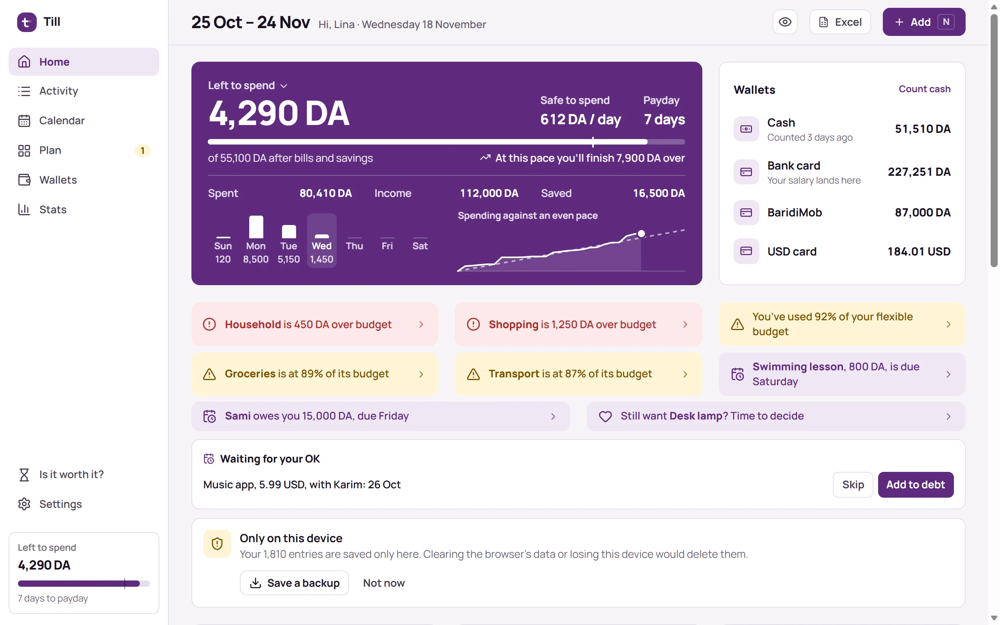
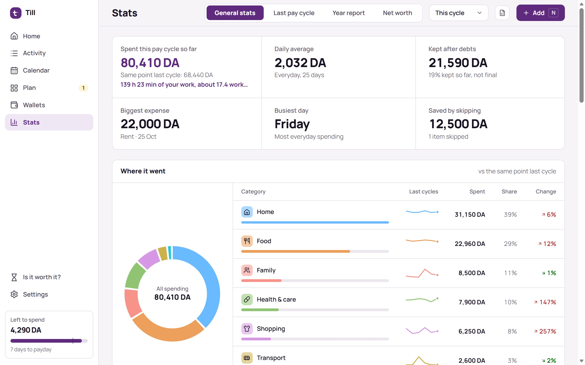
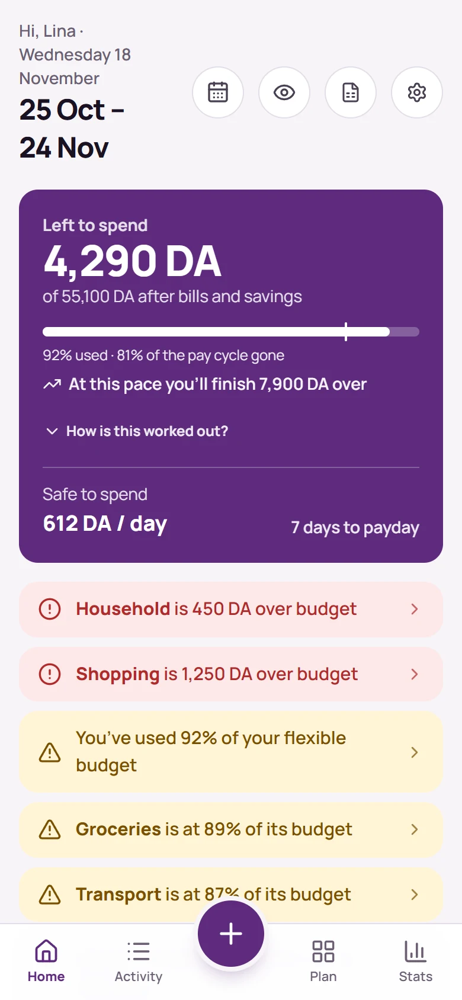

# Till

What's left till payday. A personal budget app for one person: enter your pay, payday and bills once, log what you spend in cash or by card, and see what's left, what's safe to spend today, and what any price costs in hours of work.

It runs in the browser, installs on a phone like an app and works offline. Your data stays on your device unless you choose to sync it, end-to-end encrypted.

**Live site:** https://till-expenses.web.app



| Stats | On a phone |
|---|---|
|  |  |

(The screenshots use made-up demo data.)

## Try it

Requires Node.js 20.19+ or 22.12+ and [pnpm](https://pnpm.io).

```bash
pnpm install
pnpm dev          # http://localhost:5173
```

That is all it takes: with no settings, Till is fully usable on one device, nothing contacts any server, and sync and closed-app reminders are simply not there. In development, `/ui` shows every building block of the interface on one page.

Other commands: `pnpm build`, `pnpm preview` (production build with the service worker), `pnpm lint`, `pnpm test`, `pnpm test:push` (the push server), `pnpm test:sync` (sync on the Firebase emulators, needs Java).

## Run your own

Sync and reminders while the app is closed need your own free Firebase project and Cloudflare account. Copy `.env.example` to `.env.local`, and follow **[docs/SELF-HOSTING.md](docs/SELF-HOSTING.md)**. The guide also covers deploying, customising the privacy policy, and troubleshooting.

## What it does

- **Home:** what's left to spend this pay cycle, a safe amount per day, days to payday, anything that needs attention (limits, bills and debts due, cash count, wishlist), where the money went (a small ring by main category, each opening its stats), wallets, bills, goals, debts and recent entries
- **Quick add:** an expense in a few taps with a keypad, categories ordered by use, and Cash or Card; also income, money put into or taken out of a goal, and cash withdrawals
- **Refunds and split purchases:** money back for a purchase takes it off that category's spending instead of counting as income, and one receipt can be split across several categories
- **One-tap items:** save what you buy often, like "Coffee, 250 DA", and one tap in the + sheet logs it, with Undo
- **Activity:** every entry grouped by day, with search and filters, or as a **calendar**: each month's days shaded by what you spent, with bills, paydays, goal and fund dates, debts and instalments on their day. Tap a day for its details, or to add an entry on it
- **Tags:** tag entries across categories, like "Wedding" or "Trip to Oran", and see what it cost in total over every pay cycle: spent less money back, what came in for it, and the categories it went on
- **Plan:** spending limits per category (they reset on payday), bills you mark as paid, savings goals with an on-track check, and debts: money you lent or borrowed, and things you pay off in instalments
- **Funds:** money put aside for costs that come back, like insurance, back to school, Ramadan or Eid (on the Islamic calendar). Home asks for each month's share in one tap. A yearly bill can have its own fund that pays it when it's due, so that cycle isn't wrecked, and in season the + sheet offers to pay from a fund
- **Wallets:** as many cash and bank wallets as you need, each in its own currency, moving money between them, and a cash count to catch what you forgot to log
- **Net worth:** wallets, goals, what you're owed and assets like gold (by the gram), a flat or a car, less what you owe, with a line of how it has changed month by month. Assets are worth what you say, and you update them when they change. One total per currency
- **Income:** each payday, Home asks whether your pay arrived: as expected, a different amount, or not at all. Your budget starts from what really came in. Monthly, every 2 weeks, weekly or irregular pay (budget from what you've received, or from a monthly estimate), and any number of other regular incomes
- **Other currencies:** an expense, income or debt can be in any currency. There are no exchange rates: amounts in different currencies are never added together, and your budget counts your main currency
- **Main categories:** categories sit under main ones (Home, Food, Transport, Health & care, Shopping, Leisure, Family, Other), each in its own pastel colour, with limits on either level. **Activity opens on stats**: a donut by main category, then a category's own stats, then its entries.
- **Stats:** where your pay goes, income against spending per pay cycle, where the money went (with a share ring and each category's trend), day by day, pace, savings rate after debts, debts over time, cash vs card and hours of work, each chart with a table view. Click anything (a category, a day, a debt, a line of your pay) and its entries open in a **details panel** beside the page, with a link to the same entries in Activity; Activity links back with **See in Stats**. A **review** of each finished pay cycle (on Home in its first days) says how it went and what to adjust, with a button for each; Home forecasts where the cycle is heading; and a **year report** prints or saves as a PDF
- **Is it worth it?:** a price in hours of work, what it does to your budget and goals, then skip it, buy it or add it to a wishlist
- **Reminders:** a weekly "anything to log?" reminder and bill notifications. They work while the app is open or in the background, and, if you switch it on, also while the app is closed (see [Reminders while the app is closed](#reminders-while-the-app-is-closed))
- **Privacy:** a PIN lock, with fingerprint or face where the device has them, that comes back after the app has been left for a while; and a switch (the eye on Home) that hides every amount on a phone others can see. The lock is a privacy screen, not encryption, and both stay on the device
- **Settings:** pay and working hours, categories, reminders and alerts, theme, language, backup and restore, spreadsheet export
- **Languages:** English, French and Arabic (right to left). A new install follows the browser's language

The budget month is a **pay cycle**: from payday to the day before the next payday (e.g. 25 Oct – 24 Nov), or 7 or 14 days with weekly and biweekly pay, when each cycle carries its share of monthly bills, goals and limits.

## Reminders while the app is closed

A closed web app can't run timers, so these notifications come from a small server: a **Cloudflare Worker** in [push-server/](push-server/). Cloudflare's free plan runs it, and signing up needs no card.

- The app registers this device (`PUT /push/devices/:id`) with its push subscription and the little the server needs to decide when to notify it. The server keeps that in Workers KV and forgets devices that haven't checked in for 180 days.
- A cron trigger runs every 15 minutes and sends the weekly reminder (within 3 hours of the chosen time, in the device's time zone, only when the 7 days before it have no expenses) and bills due today or tomorrow or late (between 9:00 and 21:00). It uses the same notification tags as the app, so nothing shows twice.

Messages go out as standard **Web Push**: RFC 8291 encryption and VAPID signing, written with the Web Crypto API in [webpush.ts](push-server/src/webpush.ts) and tested against the RFC's own example and the `web-push` library. Chrome, Edge, Firefox and Safari 16.4+ (app on the Home Screen) all deliver them. Nothing from Firebase or Cloudflare is added to the app bundle.

**What leaves the device**, and only when the "Also when the app is closed" switch in Settings › Reminders is on: the reminder day and time, the time zone, the dates (not amounts) of expenses logged by hand in the last two weeks, the week whose reminder you dismissed, and unpaid bills due within two weeks (id and due date). A bill's name and amount go too, but sealed with an AES-GCM key made on the device that never leaves it ([pushSeal.ts](src/app/pushSeal.ts)): the server can't read them and only passes them on, and the device's service worker opens them when the notification arrives. Without that key (site data cleared) the notification says "A bill is due tomorrow". It's stored under a random device id, replaced on every change, and deleted when you switch reminders off or when the push subscription dies. Devices saved by older versions with names in the clear are cleaned on the server's next run.

Setting it up is in [docs/SELF-HOSTING.md](docs/SELF-HOSTING.md).

## Sync with Google

**Settings › Sync › Sign in with Google** keeps a copy of your data online, so it survives a lost phone and works across devices. On a new device, the first setup screen offers the same button and brings everything back. It's optional (and only there when you set it up, see below), and the app stays fully usable offline: changes wait on the device and go out when it's back online.

- **End-to-end encrypted:** nothing readable leaves the device, so nobody but the person can read their data, including whoever runs the Firebase project. The first device asks for a **sync passphrase** (12 characters or more) and shows a **recovery key** to keep; each new device asks for the passphrase once. [src/sync/vault.ts](src/sync/vault.ts) has the scheme:
  - A random 256-bit master key per account. Online it exists only locked twice at `users/{uid}/vault/key`: with a key stretched from the passphrase (PBKDF2-SHA-256, 600,000 iterations, salted) and with the recovery key (160 random bits, shown as 32 Crockford base32 characters). Neither the passphrase nor the recovery key is ever sent.
  - Each record is sealed whole (AES-256-GCM, fresh nonce, padded to 256 bytes) with the account, document and key bound in, so it can't be moved or swapped unnoticed. Document ids are HMACs of the record ids, so even ids like `salary-2026-10-25` don't show. Online there's only the email (Google sign-in), random ids, server write times and roughly how much data there is.
  - Each device keeps its working keys in IndexedDB as non-extractable CryptoKeys, removed on sign-out. A new passphrase or recovery key re-locks the same master key, so other devices keep syncing. Forgetting both means *Start over*: the online copy is deleted and a device that still has the data puts it back under a new passphrase. Nobody can recover it otherwise.
- **Where it lives:** Cloud Firestore on your Firebase project, free Spark plan, one sealed document per record at `users/{uid}/records/{id}`. [firestore.rules](firestore.rules) lets only the signed-in owner in, and only accepts sealed records: the plaintext ones older versions wrote are refused. Any left online are merged into the first device that sets up the passphrase, sent back sealed, then deleted.
- **Merging:** the later change to each record wins, compared on `updatedAt`. That uses each device's clock, so a phone set to the wrong time can win when it shouldn't. Deletes are soft, so they merge the same way. A device always reads before it writes, and only writes once the server has confirmed the key online is still its own. The logic is in [src/sync/](src/sync/): `records.ts` (merge), `engine.ts` (when to read and write), `vault.ts` (encryption), `sealedRemote.ts` (sealing on the way out, opening on the way in), `firestoreRemote.ts` and `firebase.ts` (Firebase), `index.ts` (what the app calls).
- **Getting out:** *Sign out* keeps the data on the device and online. *Delete online copy* removes the records, the locked key and the Google sign-in from the project; other devices stop syncing and sign out. *Delete everything* removes both. A device refuses to sync with a second Google account until its data is deleted, so two people's money can't mix.
- **Content-Security-Policy:** the built page only runs its own scripts (and Google sign-in's) and only connects to Firebase and the push server, so even injected code couldn't send data elsewhere ([vite.config.ts](vite.config.ts)). Pages can't be framed by other sites (`firebase.json`).

`pnpm test:sync` runs the sealed Firestore adapter and the real security rules in the Firebase emulators (needs Java), including what the server actually holds. Deploying is covered in [docs/SELF-HOSTING.md](docs/SELF-HOSTING.md).

## Your data

The **privacy policy** is in the app at `/privacy`, in all three languages, linked from Settings › About. It's built from the same numbers and menu labels as the code ([src/privacy/](src/privacy/)), and `policy.test.ts` fails if they drift apart; who runs Till and the contact address are in [operator.ts](src/privacy/operator.ts). Change `POLICY_DATE` with any change of substance.

Everything is saved in your browser on your device (IndexedDB). Apart from the reminder details above, nothing is sent anywhere unless you turn on sync. Clearing the browser's site data deletes it, so turn on sync or use **Settings › Your data › Save a backup** now and then. A backup restores on any device; **Export to a spreadsheet** gives you every transaction as a CSV file, and **Import from a spreadsheet** brings entries in from a CSV (a sheet you kept, or your bank’s statement): it matches the columns, shows a preview and can be undone. Each page also has its own **Excel** button in its header, which saves what that page shows, with its period and filters, as an `.xlsx` file. The file is made on your device and works offline.

## Project layout

```
src/
  app/          App, router, layout, navigation, service worker, install, reminders, push
  config/       the one reader of the optional cloud settings
  pages/        one file per screen (plan/, settings/, onboarding/)
  components/   ui/ (the design system) and feature components
  lib/          all money and date calculations, with tests next to them
  store/        Zustand store saved to IndexedDB, migrations, backup
  sync/         end-to-end encrypted sync
  i18n/         every piece of text the app shows, in English, French and Arabic
  types/        the data model
push-server/    Cloudflare Worker: the push server (schedule.ts and webpush.ts are the tested logic)
scripts/        deploy and check scripts
docs/           ARCHITECTURE.md, SELF-HOSTING.md, brand assets
```

- [docs/ARCHITECTURE.md](docs/ARCHITECTURE.md): how the app works
- [docs/SELF-HOSTING.md](docs/SELF-HOSTING.md): running your own copy
- [SECURITY.md](SECURITY.md): reporting a vulnerability

## Tech stack

- [Vite 8](https://vite.dev) + [React 19](https://react.dev) + TypeScript
- [Tailwind CSS 4](https://tailwindcss.com) (theme defined in CSS with `@theme`), light and dark
- [Zustand](https://zustand.docs.pmnd.rs) for state, saved to IndexedDB with `idb-keyval`
- [React Router](https://reactrouter.com), [Recharts](https://recharts.org), [date-fns](https://date-fns.org), [Radix Dialog](https://www.radix-ui.com), [Lucide](https://lucide.dev) icons
- `vite-plugin-pwa` (Workbox) for installing and working offline
- [Vitest](https://vitest.dev) for tests
- optional [Firebase](https://firebase.google.com) (Hosting, Firestore, Authentication) for sync and a [Cloudflare Worker](https://workers.cloudflare.com) with KV and a cron trigger for push reminders

## License

[MIT](LICENSE): you may use, copy, modify, merge, publish, distribute, sublicense and sell copies, including in your own projects, as long as the copyright notice and licence text stay with it. The software is provided as is, without warranty.
